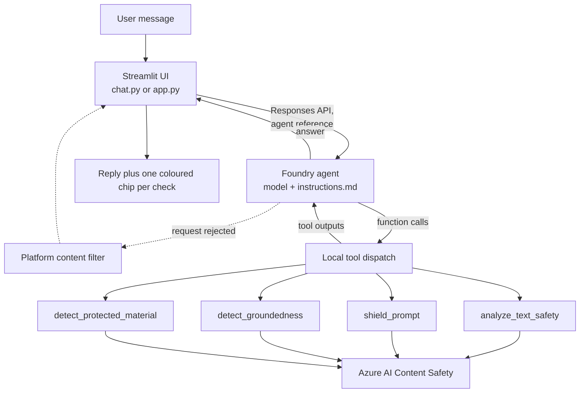

# Content Safety Agent

[](https://github.com/ArchitectsBench/content-safety-agent/actions/workflows/tests.yml)

An Azure AI Foundry agent that screens every message with four Azure AI Content Safety checks before it answers, and shows the verdict of each check beside the reply.

It is a proof of concept for one question: what does each safety layer actually catch, and where does it stay silent?

## The four checks

Each check is a function tool the agent calls. The implementations are in `content_safety_tools.py`.

| Tool | What it detects | API | Version |
|---|---|---|---|
| `analyze_text_safety` | Hate, sexual, violence and self-harm content, each scored 0 to 6; a score above 2 is flagged | `azure-ai-contentsafety` SDK | Generally available |
| `shield_prompt` | Jailbreak attempts in the user prompt, and injected instructions inside attached documents | REST `text:shieldPrompt` | `2024-09-01` |
| `detect_groundedness` | Claims in an AI answer that its source text does not support, with the ungrounded percentage | REST `text:detectGroundedness` | `2024-09-15-preview` |
| `detect_protected_material` | Known copyrighted text, and code matching public repositories | REST `text:detectProtectedMaterial` | Text `2024-09-01`; code `2024-09-15-preview` |

The agent's instructions (`instructions.md`) make the first two checks mandatory on every message. Groundedness runs only when the user supplies an answer and its sources; protected material runs when the message contains quoted text or code.

## How a message flows



The tools run in the client process, not inside the agent service. The agent asks for a tool call, the client runs it against Content Safety and returns the JSON result, and the loop repeats until the agent has no calls left. Each message uses a fresh conversation, which is deleted afterwards.

## Three layers, and where each stays silent

| Layer | Acts when | Does not act when |
|---|---|---|
| Platform content filter on the model deployment | The input is explicitly harmful. The request is rejected before the agent runs, and the UI shows the filter's own severity labels. | The content is mild or borderline; it passes through to the agent. |
| Content Safety tools called by the agent | Text scores above the severity threshold, a jailbreak or injection pattern is found, an answer is ungrounded, or protected material is matched. | A request asks for harmful instructions in neutral language. The tools score the text, not the intent, and return clean results. |
| Agent instructions | A request is harmful in intent although every tool returned clean. The agent declines and says the decision came from the nature of the request, not from a tool. | It is not a guarantee. This layer is the model following its instructions. |

Seeing all three in one UI is the point of the project: a clean tool score is not the same as a safe request.

## What is in the repository

| File | What it does |
|---|---|
| `agent.py` | Registers the agent (model, instructions, four tool definitions) in a Foundry project. Each run creates a new agent version. |
| `content_safety_tools.py` | The four tool implementations. Each returns a JSON string with the findings and a one-line verdict. |
| `instructions.md` | The agent's system prompt: which checks to run and how to word each outcome |
| `chat.py` | Chat-style Streamlit UI: the agent's reply first, then compact colour-coded chips for each check |
| `app.py` | Dashboard-style Streamlit UI showing the detail of every tool call |
| `run_agent.py` | Command-line harness that runs four scenarios end to end: safe, harmful, ungrounded, protected material |
| `test_prompts.md` | Inputs to try, grouped by the check they exercise, with expected outcomes |
| `tests/` | Offline tests for the four tools: 20 cases that run without Azure access |
| `.env.template` | The three settings to fill in |

## Run it

You need:

- An Azure AI Foundry project with a deployed chat model.
- An Azure AI Content Safety resource.
- The Azure CLI, signed in with `az login`.
- Access for your identity to both: the Azure AI User role on the Foundry project, and a role that allows Content Safety calls, such as Cognitive Services User.

```bash
git clone https://github.com/ArchitectsBench/content-safety-agent.git
cd content-safety-agent
python3 -m venv .venv && source .venv/bin/activate
pip install -r requirements.txt

cp .env.template .env     # then fill in the three values
az login
```

| Setting | Where to find it |
|---|---|
| `AZURE_AI_FOUNDRY_PROJECT_ENDPOINT` | Foundry portal, your project, Overview. Format: `https://<resource>.services.ai.azure.com/api/projects/<project>` |
| `MODEL_DEPLOYMENT_NAME` | The name of the model deployment in that project |
| `CONTENT_SAFETY_ENDPOINT` | Azure portal, your Content Safety resource, Keys and Endpoint |

Register the agent, then start a UI:

```bash
python agent.py            # registers "content-safety-ner-analyst" in the project
streamlit run chat.py      # chat UI on http://localhost:8501
```

Or run the scripted scenarios without a UI:

```bash
python run_agent.py
```

## Test it offline

The tests replace the SDK client, the HTTP calls and the credential with fakes, so they need no Azure account, read no `.env` file and cost nothing.

```bash
pip install -r requirements-test.txt
python -m pytest tests
```

They cover what each tool does with a service reply: the verdict it writes, the request it sends, the severity threshold, and that a failed call comes back as an `ERROR` verdict, never a silent pass. They run on every push.

## Design notes

- **No keys.** Every call authenticates with `DefaultAzureCredential`, so local runs use your `az login` session and a hosted copy can use a managed identity without code changes.
- **Verdicts are data.** Each tool returns structured JSON plus a plain-language verdict, so the UI can draw chips from the data while the agent writes the explanation.
- **Tool failures are visible.** A tool that cannot reach the service returns an `ERROR` verdict instead of a silent pass.
- **Documents for Prompt Shield** are passed as one pipe-separated string (`doc1|doc2`).
- **The portal cannot edit function tools.** The Foundry playground can run this agent, but tool definitions change only through `agent.py`.

## Limits

- Two of the calls use preview API versions (groundedness, and protected-material detection for code). Preview APIs can change or be withdrawn.
- The automated tests cover the tool logic only, against faked service replies. The agent, the instructions and the two UIs are exercised only by `run_agent.py`, a scripted demonstration against live services.
- The agent's name contains "ner" for historical reasons. The project does no entity recognition.
- Running it calls billed Azure services.
